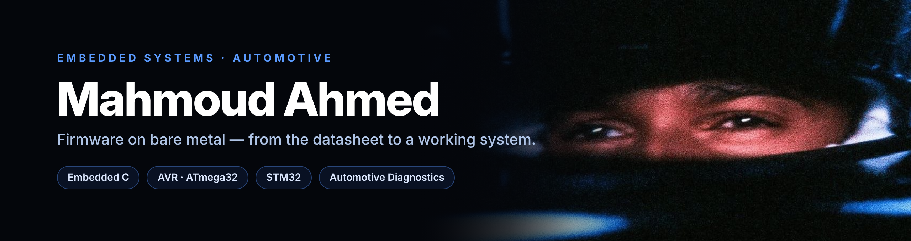
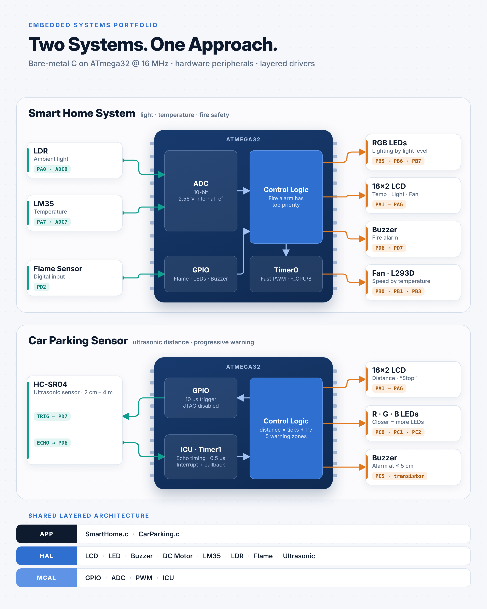

  

Banner photo: Lewis Hamilton

## About Me

Electronics & Communications Engineering student focused on **embedded systems**.
I write firmware in **bare-metal C** for AVR and STM32 microcontrollers, and I care most about
understanding the system underneath the code: registers, timers, interrupts, clocks and the datasheet.

- Currently completing an **Embedded Systems diploma** — final project in progress: **Automotive Diagnostics**
- Building drivers with a clean **layered architecture** (MCAL / HAL / Application)
- Team leader of **ECOFAB** — **1st place nationally**, Digital Egypt Pioneers Initiative (DEPI) Round 3

---

## Featured Projects

| Project | Description | Stack |
|---|---|---|
| [**Smart Home Automation**](https://github.com/mahmoudahmed-ece/SMART__HOME__AUTOMATION) | Automatic RGB lighting (LDR), temperature-based fan speed (LM35 + Timer0 PWM) and a priority fire alarm, with live readings on an LCD. | ATmega32 · ADC · PWM · Embedded C |
| [**Car Parking Sensor**](https://github.com/mahmoudahmed-ece/CAR__PARKING__SYSTEM) | HC-SR04 distance measurement with the Timer1 Input Capture Unit (0.5 µs resolution), progressive LED and buzzer warnings. | ATmega32 · ICU · Interrupts · Embedded C |
| [**Smart Diabetic Foot Shoe**](https://github.com/mahmoudahmed-ece/DIABETIC-FEET-ULCERS) | Wearable monitoring firmware: plantar pressure, foot temperature and humidity sensing with a risk score, alerts and UART data streaming. | STM32F103 · HAL · ADC · UART |
| [**ECOFAB**](https://github.com/mahmoudahmed-ece/ECOFAB) | Platform for turning textile waste into sustainable value. **1st place nationally — DEPI Round 3** (team leader). | React · Vite · JavaScript |
| [**C Programming Internship**](https://github.com/mahmoudahmed-ece/codealpha_tasks) | CodeAlpha internship tasks: matrix operations and a student management system. | C |

  

---

## Tech Stack

**Languages**

**Microcontrollers**

**Tools**

**Peripherals & Concepts**

`GPIO` · `ADC` · `Timers` · `PWM` · `Input Capture (ICU)` · `Interrupts & Callbacks` · `UART` · `Character LCD` · `Sensor interfacing` · `Layered driver architecture`

---

## Connect

